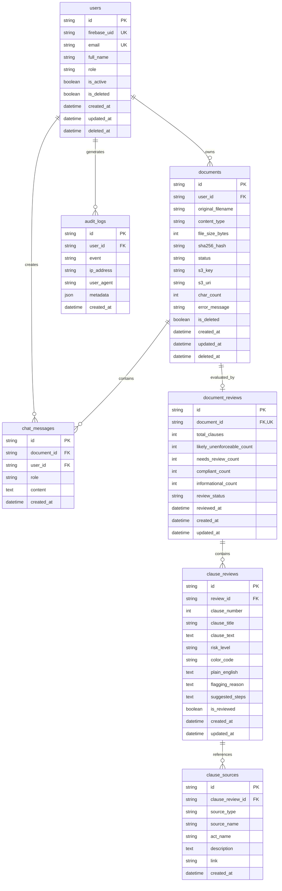

# ClauseGuard — Database Schema & Data Dictionary

This document details the database architecture, entity-relationship model, tables, columns, indexes, constraints, and privacy/audit design for ClauseGuard.

---

## 1. Database Architecture & Technology

- **Database Engine**: MySQL 8.0+
- **ORM / Migrations**: SQLAlchemy 2.0 (Async with `aiomysql`) + Alembic (`alembic.ini`)
- **Primary Keys**: 36-character UUIDv4 strings (avoids sequential ID scraping / enumeration attacks).
- **Timezone**: All timestamps are stored in UTC (`DateTime(timezone=True)`).
- **Soft Delete Design**: Core entities like `users` and `documents` use soft-deletion (`is_deleted`, `deleted_at`) to comply with GDPR audit retention without physically wiping forensic history prematurely.

---

## 2. Entity-Relationship Diagram (ERD)



---

## 3. Detailed Table Specifications

### 3.1 `users`
Stores user profile information linked to Firebase Authentication.

| Column | Type | Constraints | Description |
| :--- | :--- | :--- | :--- |
| `id` | `VARCHAR(36)` | `PRIMARY KEY` | UUIDv4 identifier |
| `firebase_uid` | `VARCHAR(128)` | `UNIQUE, NOT NULL, INDEX` | Unique ID from Firebase Auth |
| `email` | `VARCHAR(255)` | `UNIQUE, NOT NULL, INDEX` | User's verified email address |
| `full_name` | `VARCHAR(255)` | `NULLABLE` | Display name |
| `role` | `ENUM('user', 'admin')`| `NOT NULL, DEFAULT 'user'` | Access control role |
| `is_active` | `BOOLEAN` | `NOT NULL, DEFAULT TRUE` | Active account flag |
| `is_deleted` | `BOOLEAN` | `NOT NULL, DEFAULT FALSE` | Soft-delete status |
| `created_at` | `DATETIME(6)` | `NOT NULL, DEFAULT NOW()` | Creation timestamp |
| `updated_at` | `DATETIME(6)` | `NOT NULL, ON UPDATE NOW()` | Last update timestamp |
| `deleted_at` | `DATETIME(6)` | `NULLABLE` | Timestamp when user closed account |

---

### 3.2 `audit_logs`
Immutable security and audit ledger capturing authentication, upload, and GDPR export events.

| Column | Type | Constraints | Description |
| :--- | :--- | :--- | :--- |
| `id` | `VARCHAR(36)` | `PRIMARY KEY` | UUIDv4 identifier |
| `user_id` | `VARCHAR(36)` | `FK(users.id), INDEX` | User performing the action |
| `event` | `VARCHAR(64)` | `NOT NULL, INDEX` | e.g. `LOGIN`, `UPLOAD_DOCUMENT`, `GDPR_EXPORT` |
| `ip_address` | `VARCHAR(45)` | `NULLABLE` | IPv4 or IPv6 client address |
| `user_agent` | `VARCHAR(512)` | `NULLABLE` | Browser / device user-agent string |
| `metadata_json` | `TEXT / JSON` | `NULLABLE` | Contextual event parameters |
| `created_at` | `DATETIME(6)` | `NOT NULL, DEFAULT NOW()` | Log timestamp |

---

### 3.3 `documents`
Tracks uploaded lease agreements, processing lifecycle status, S3 storage keys, and cryptographic hashes.

| Column | Type | Constraints | Description |
| :--- | :--- | :--- | :--- |
| `id` | `VARCHAR(36)` | `PRIMARY KEY` | UUIDv4 document identifier |
| `user_id` | `VARCHAR(36)` | `FK(users.id), NOT NULL, INDEX` | Owner of the document |
| `original_filename`| `VARCHAR(255)` | `NOT NULL` | Uploaded filename |
| `content_type` | `VARCHAR(100)` | `NOT NULL` | MIME type (e.g. `application/pdf`, `image/png`) |
| `file_size_bytes` | `INTEGER` | `NOT NULL` | Original payload size (max 20MB) |
| `sha256_hash` | `CHAR(64)` | `NOT NULL, INDEX` | SHA-256 integrity hash of original upload |
| `status` | `ENUM('PENDING', 'PROCESSING', 'COMPLETED', 'FAILED')` | `NOT NULL, DEFAULT 'PENDING'` | Pipeline lifecycle status |
| `s3_key` | `VARCHAR(512)` | `NULLABLE` | S3 object key (e.g. `documents/lease_xyz.txt`) |
| `s3_uri` | `VARCHAR(1024)`| `NULLABLE` | Full S3 URI (`s3://bucket/key`) |
| `char_count` | `INTEGER` | `NULLABLE` | Character count of extracted redacted text |
| `error_message` | `TEXT` | `NULLABLE` | Error detail if pipeline failed |
| `is_deleted` | `BOOLEAN` | `NOT NULL, DEFAULT FALSE, INDEX` | Soft-delete flag |
| `created_at` | `DATETIME(6)` | `NOT NULL, DEFAULT NOW(), INDEX` | Upload timestamp |
| `updated_at` | `DATETIME(6)` | `NOT NULL, ON UPDATE NOW()` | Status update timestamp |
| `deleted_at` | `DATETIME(6)` | `NULLABLE` | Soft-delete timestamp |

---

### 3.4 `document_reviews`
Stores aggregated review scores and risk summaries for a document.

| Column | Type | Constraints | Description |
| :--- | :--- | :--- | :--- |
| `id` | `VARCHAR(36)` | `PRIMARY KEY` | UUIDv4 review identifier |
| `document_id` | `VARCHAR(36)` | `FK(documents.id), UNIQUE, NOT NULL, INDEX` | Target document (One-to-One) |
| `total_clauses` | `INTEGER` | `NOT NULL, DEFAULT 0` | Total clauses evaluated |
| `likely_unenforceable_count` | `INTEGER` | `NOT NULL, DEFAULT 0` | High-risk clauses count |
| `needs_review_count` | `INTEGER` | `NOT NULL, DEFAULT 0` | Cautionary clauses count |
| `compliant_count` | `INTEGER` | `NOT NULL, DEFAULT 0` | Standard/compliant clauses count |
| `informational_count` | `INTEGER` | `NOT NULL, DEFAULT 0` | Informative clauses count |
| `review_status` | `ENUM('pending', 'in_progress', 'completed', 'failed')` | `NOT NULL, DEFAULT 'completed'` | Review evaluation state |
| `reviewed_at` | `DATETIME(6)` | `NULLABLE` | Timestamp when ML analysis finished |
| `created_at` | `DATETIME(6)` | `NOT NULL, DEFAULT NOW()` | Creation timestamp |
| `updated_at` | `DATETIME(6)` | `NOT NULL, ON UPDATE NOW()` | Modification timestamp |

---

### 3.5 `clause_reviews`
Detailed clause-by-clause legal audit matching ClauseGuard's UI cards.

| Column | Type | Constraints | Description |
| :--- | :--- | :--- | :--- |
| `id` | `VARCHAR(36)` | `PRIMARY KEY` | UUIDv4 clause review identifier |
| `review_id` | `VARCHAR(36)` | `FK(document_reviews.id, ON DELETE CASCADE), NOT NULL, INDEX` | Parent document review |
| `clause_number` | `INTEGER` | `NOT NULL` | Sequential clause number in the lease |
| `clause_title` | `VARCHAR(255)` | `NOT NULL` | Heading (e.g. `Right of Entry`, `Deposit Deductions`) |
| `clause_text` | `TEXT` | `NOT NULL` | Exact extracted text from the lease |
| `risk_level` | `ENUM('likely_unenforceable', 'needs_review', 'compliant', 'informational')` | `NOT NULL` | Irish law risk tier |
| `color_code` | `VARCHAR(7)` | `NOT NULL, DEFAULT '#6B7280'` | Hex color (`#DC2626`, `#EAB308`, `#16A34A`, `#6B7280`) |
| `plain_english` | `TEXT` | `NULLABLE` | Simplified explanation for tenant |
| `flagging_reason`| `TEXT` | `NULLABLE` | Legal conflict justification |
| `suggested_steps`| `TEXT` | `NULLABLE` | JSON array of suggested negotiation actions |
| `is_reviewed` | `BOOLEAN` | `NOT NULL, DEFAULT FALSE` | Checkbox state in tenant UI |
| `created_at` | `DATETIME(6)` | `NOT NULL, DEFAULT NOW()` | Timestamp |
| `updated_at` | `DATETIME(6)` | `NOT NULL, ON UPDATE NOW()` | Timestamp |

---

### 3.6 `clause_sources`
Legal references, statutes, and Residential Tenancies Board (RTB) citations backing up each clause evaluation.

| Column | Type | Constraints | Description |
| :--- | :--- | :--- | :--- |
| `id` | `VARCHAR(36)` | `PRIMARY KEY` | UUIDv4 source identifier |
| `clause_review_id`| `VARCHAR(36)` | `FK(clause_reviews.id, ON DELETE CASCADE), NOT NULL, INDEX` | Associated clause review |
| `source_type` | `ENUM('legislation', 'rtb_guidance', 'case_law', 'other')` | `NOT NULL` | Classification of the legal authority |
| `source_name` | `VARCHAR(512)` | `NOT NULL` | e.g. `Residential Tenancies Act 2004` |
| `act_name` | `VARCHAR(512)` | `NULLABLE` | Specific subsection (e.g. `Section 16(b)`) |
| `description` | `TEXT` | `NULLABLE` | Summary of the statutory requirement |
| `link` | `VARCHAR(1024)`| `NULLABLE` | Direct URL to Irish Statute Book or RTB guidance |
| `created_at` | `DATETIME(6)` | `NOT NULL, DEFAULT NOW()` | Timestamp |

---

### 3.7 `chat_messages`
Persists conversational exchanges between the tenant and the ClauseGuard AI Assistant for specific leases.

| Column | Type | Constraints | Description |
| :--- | :--- | :--- | :--- |
| `id` | `VARCHAR(36)` | `PRIMARY KEY` | UUIDv4 message identifier |
| `document_id` | `VARCHAR(36)` | `FK(documents.id, ON DELETE CASCADE), NOT NULL, INDEX` | Referenced lease document |
| `user_id` | `VARCHAR(36)` | `FK(users.id, ON DELETE CASCADE), NOT NULL, INDEX` | Requesting user |
| `role` | `ENUM('user', 'model')`| `NOT NULL` | Message author (`user` = tenant, `model` = AI) |
| `content` | `TEXT` | `NOT NULL` | Message content |
| `created_at` | `DATETIME(6)` | `NOT NULL, DEFAULT NOW(), INDEX` | Sent timestamp (used for chronological sorting) |

---

## 4. Alembic Migration History

| Version ID | File Name | Description |
| :--- | :--- | :--- |
| `0001` | `0001_initial_schema.py` | Creates `users` and `audit_logs` tables. |
| `0002` | `0002_add_documents_table.py` | Creates `documents` table with SHA-256 hash and S3 references. |
| `0003` | `0003_add_chat_and_review_tables.py` | Creates `document_reviews`, `clause_reviews`, `clause_sources`, and `chat_messages`. |

To run all migrations up to date:
```bash
alembic upgrade head
```
