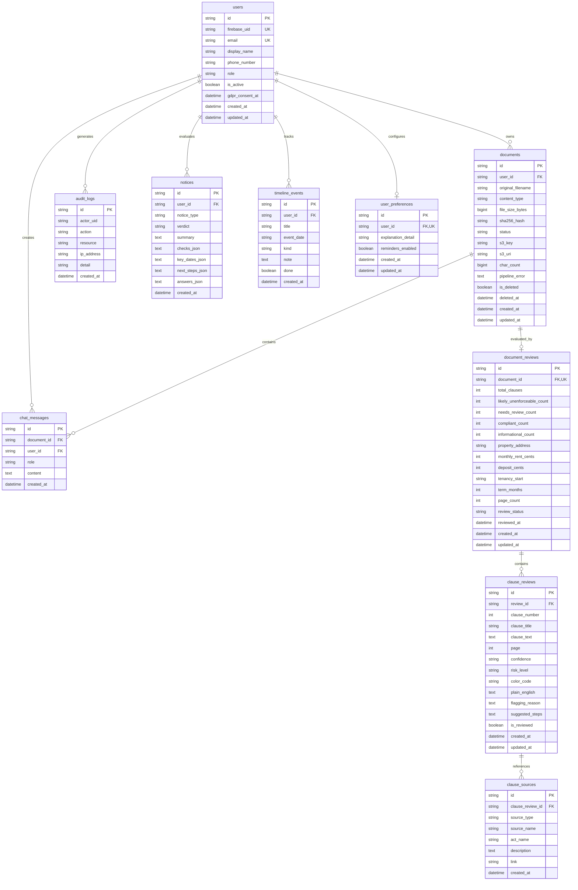

# ClauseGuard — Database Schema & Data Dictionary

This document details the database architecture, entity-relationship model, tables, columns, indexes, constraints, and privacy/audit design for ClauseGuard.

---

## 1. Database Architecture & Technology

- **Database Engine**: MySQL 8.0+
- **ORM / Migrations**: SQLAlchemy 2.0 (Async with `aiomysql`) + Alembic (`alembic.ini`)
- **Primary Keys**: 36-character UUIDv4 strings (avoids sequential ID scraping / enumeration attacks).
- **Timezone**: All timestamps are stored in UTC (`DateTime(timezone=True)`).
- **Soft Delete Design**: Core entities like `users` and `documents` support soft-deletion (`is_deleted`, `deleted_at`) for audit compliance, while `DELETE /api/me` triggers cascading GDPR wipes of stored files and associated entities.

---

## 2. Entity-Relationship Diagram (ERD)



---

## 3. Data Dictionary

### 3.1 `users`
Stores user profile records linked to Firebase Authentication accounts.

| Column | Type | Constraints | Description |
| :--- | :--- | :--- | :--- |
| `id` | `VARCHAR(36)` | `PRIMARY KEY` | UUIDv4 user identifier |
| `firebase_uid` | `VARCHAR(128)` | `UNIQUE, NOT NULL, INDEX` | Firebase Authentication UID |
| `email` | `VARCHAR(255)` | `UNIQUE, NOT NULL, INDEX` | User's verified email address |
| `display_name` | `VARCHAR(256)` | `NULLABLE` | User's full name |
| `phone_number` | `VARCHAR(32)` | `NULLABLE` | Contact phone number |
| `role` | `ENUM('tenant', 'landlord', 'admin')` | `NOT NULL, DEFAULT 'tenant'` | Authorization role |
| `is_active` | `BOOLEAN` | `NOT NULL, DEFAULT TRUE` | False if user deactivated account |
| `gdpr_consent_at` | `DATETIME(6)` | `NULLABLE` | Timestamp when user accepted GDPR terms |
| `created_at` | `DATETIME(6)` | `NOT NULL, DEFAULT NOW()` | Creation timestamp |
| `updated_at` | `DATETIME(6)` | `NOT NULL, ON UPDATE NOW()` | Last update timestamp |

---

### 3.2 `audit_logs`
Immutable compliance audit trail recording security events and account changes.

| Column | Type | Constraints | Description |
| :--- | :--- | :--- | :--- |
| `id` | `VARCHAR(36)` | `PRIMARY KEY` | UUIDv4 log entry identifier |
| `actor_uid` | `VARCHAR(128)` | `NOT NULL, INDEX` | Firebase UID of user performing action |
| `action` | `VARCHAR(64)` | `NOT NULL, INDEX` | Event type (`REGISTER`, `LOGIN`, `LOGOUT`, `PROFILE_UPDATED`, etc.) |
| `resource` | `VARCHAR(256)` | `NOT NULL` | Target resource (e.g. `user:glJb2C...`) |
| `ip_address` | `VARCHAR(45)` | `NOT NULL` | Client IPv4 / IPv6 address |
| `detail` | `TEXT` | `NULLABLE` | Supplemental JSON or string details |
| `created_at` | `DATETIME(6)` | `NOT NULL, DEFAULT NOW(), INDEX` | Event timestamp |

---

### 3.3 `documents`
Tracks uploaded lease PDF/image metadata, SHA-256 integrity hash, and S3 storage keys.

| Column | Type | Constraints | Description |
| :--- | :--- | :--- | :--- |
| `id` | `VARCHAR(36)` | `PRIMARY KEY` | UUIDv4 document identifier |
| `user_id` | `VARCHAR(36)` | `FK(users.id, ON DELETE CASCADE), NOT NULL, INDEX` | Owner user ID |
| `original_filename`| `VARCHAR(512)` | `NOT NULL` | Original client file name |
| `content_type` | `VARCHAR(128)` | `NOT NULL` | MIME type verified via `python-magic` |
| `file_size_bytes` | `BIGINT` | `NOT NULL` | Size in bytes (max 25 MB) |
| `sha256_hash` | `VARCHAR(64)` | `NOT NULL, INDEX` | SHA-256 digest of original uploaded bytes |
| `s3_key` | `VARCHAR(1024)`| `NULLABLE` | S3 object key (`documents/<uid>/<uuid>.txt`) |
| `s3_uri` | `VARCHAR(1024)`| `NULLABLE` | Full S3 URI (`s3://bucket/key`) |
| `status` | `ENUM('pending', 'processing', 'completed', 'failed')` | `NOT NULL, DEFAULT 'pending'` | Extraction/redaction status |
| `char_count` | `BIGINT` | `NULLABLE` | Redacted text character count |
| `pipeline_error` | `TEXT` | `NULLABLE` | Failure detail if extraction/upload failed |
| `is_deleted` | `BOOLEAN` | `NOT NULL, DEFAULT FALSE` | Soft-delete flag |
| `deleted_at` | `DATETIME(6)` | `NULLABLE` | Soft-deletion timestamp |
| `created_at` | `DATETIME(6)` | `NOT NULL, DEFAULT NOW(), INDEX` | Upload timestamp |
| `updated_at` | `DATETIME(6)` | `NOT NULL, ON UPDATE NOW()` | Modification timestamp |

---

### 3.4 `document_reviews`
Stores aggregated review scores, structured lease terms, and risk summaries for a document.

| Column | Type | Constraints | Description |
| :--- | :--- | :--- | :--- |
| `id` | `VARCHAR(36)` | `PRIMARY KEY` | UUIDv4 review identifier |
| `document_id` | `VARCHAR(36)` | `FK(documents.id, ON DELETE CASCADE), UNIQUE, NOT NULL, INDEX` | Target document (One-to-One) |
| `total_clauses` | `INTEGER` | `NOT NULL, DEFAULT 0` | Total clauses evaluated |
| `likely_unenforceable_count` | `INTEGER` | `NOT NULL, DEFAULT 0` | High-risk clauses count (mapped to `red`) |
| `needs_review_count` | `INTEGER` | `NOT NULL, DEFAULT 0` | Cautionary clauses count (mapped to `amber`) |
| `compliant_count` | `INTEGER` | `NOT NULL, DEFAULT 0` | Standard clauses count (mapped to `green`) |
| `informational_count` | `INTEGER` | `NOT NULL, DEFAULT 0` | Informative clauses count (mapped to `grey`) |
| `property_address` | `VARCHAR(512)` | `NULLABLE` | Extracted rental property address |
| `monthly_rent_cents` | `INTEGER` | `NULLABLE` | Monthly rent in euro cents (e.g. 210000 = €2,100) |
| `deposit_cents` | `INTEGER` | `NULLABLE` | Security deposit in euro cents |
| `tenancy_start` | `VARCHAR(64)` | `NULLABLE` | Commencement date string (`YYYY-MM-DD`) |
| `term_months` | `INTEGER` | `NULLABLE` | Fixed term duration in months |
| `page_count` | `INTEGER` | `NOT NULL, DEFAULT 1` | Total evaluated lease pages |
| `review_status` | `ENUM('pending', 'processing', 'completed', 'failed')` | `NOT NULL, DEFAULT 'pending'` | Review evaluation state |
| `reviewed_at` | `DATETIME(6)` | `NULLABLE` | Timestamp when analysis completed |
| `created_at` | `DATETIME(6)` | `NOT NULL, DEFAULT NOW()` | Creation timestamp |
| `updated_at` | `DATETIME(6)` | `NOT NULL, ON UPDATE NOW()` | Modification timestamp |

---

### 3.5 `clause_reviews`
Detailed clause-by-clause legal audit matching ClauseGuard's UI cards.

| Column | Type | Constraints | Description |
| :--- | :--- | :--- | :--- |
| `id` | `VARCHAR(36)` | `PRIMARY KEY` | UUIDv4 clause review identifier |
| `review_id` | `VARCHAR(36)` | `FK(document_reviews.id, ON DELETE CASCADE), NOT NULL, INDEX` | Parent document review |
| `clause_number` | `INTEGER` | `NOT NULL` | Sequential clause number in the lease |
| `clause_title` | `VARCHAR(512)` | `NOT NULL` | Heading (e.g. `Right of Entry`, `Deposit Deductions`) |
| `clause_text` | `TEXT` | `NOT NULL` | Exact extracted text from the lease |
| `page` | `INTEGER` | `NOT NULL, DEFAULT 1` | Page number where the clause appears |
| `confidence` | `VARCHAR(32)` | `NOT NULL, DEFAULT 'high'` | Confidence classification (`high`, `medium`, `low`) |
| `risk_level` | `ENUM('likely_unenforceable', 'needs_review', 'compliant', 'informational')` | `NOT NULL` | Irish law risk tier |
| `color_code` | `VARCHAR(16)` | `NOT NULL, DEFAULT 'grey'` | Status color (`red`, `amber`, `green`, `grey`) |
| `plain_english` | `TEXT` | `NULLABLE` | Plain-English translation for tenant |
| `flagging_reason`| `TEXT` | `NULLABLE` | Statutory conflict justification |
| `suggested_steps`| `TEXT` | `NULLABLE` | JSON array of suggested next steps |
| `is_reviewed` | `BOOLEAN` | `NOT NULL, DEFAULT FALSE` | Checkbox state in tenant UI |
| `created_at` | `DATETIME(6)` | `NOT NULL, DEFAULT NOW()` | Timestamp |
| `updated_at` | `DATETIME(6)` | `NOT NULL, ON UPDATE NOW()` | Timestamp |

---

### 3.6 `clause_sources`
Legal references, statutes, and Residential Tenancies Board (RTB) citations backing up each clause evaluation.

| Column | Type | Constraints | Description |
| :--- | :--- | :--- | :--- |
| `id` | `VARCHAR(36)` | `PRIMARY KEY` | UUIDv4 source identifier |
| `clause_review_id`| `VARCHAR(36)` | `FK(clause_reviews.id, ON DELETE CASCADE), NOT NULL, INDEX` | Associated clause review |
| `source_type` | `ENUM('legislation', 'rtb_guidance', 'case_law', 'other')` | `NOT NULL` | Classification of the legal authority |
| `source_name` | `VARCHAR(512)` | `NOT NULL` | e.g. `Residential Tenancies Act 2004` |
| `act_name` | `VARCHAR(512)` | `NULLABLE` | Specific section (e.g. `Section 12(1)(a)`) |
| `description` | `TEXT` | `NULLABLE` | Summary of the statutory requirement |
| `link` | `VARCHAR(1024)`| `NULLABLE` | Direct URL to Irish Statute Book or RTB guidance |
| `created_at` | `DATETIME(6)` | `NOT NULL, DEFAULT NOW()` | Timestamp |

---

### 3.7 `chat_messages`
Persists conversational exchanges between the tenant and the ClauseGuard AI Assistant for specific leases.

| Column | Type | Constraints | Description |
| :--- | :--- | :--- | :--- |
| `id` | `VARCHAR(36)` | `PRIMARY KEY` | UUIDv4 message identifier |
| `document_id` | `VARCHAR(36)` | `FK(documents.id, ON DELETE CASCADE), NOT NULL, INDEX` | Referenced lease document |
| `user_id` | `VARCHAR(36)` | `FK(users.id, ON DELETE CASCADE), NOT NULL, INDEX` | Requesting user |
| `role` | `ENUM('user', 'model')`| `NOT NULL` | Message author (`user` = tenant, `model` = AI) |
| `content` | `TEXT` | `NOT NULL` | Message content |
| `created_at` | `DATETIME(6)` | `NOT NULL, DEFAULT NOW(), INDEX` | Sent timestamp (chronological sorting) |

---

### 3.8 `notices`
Stores evaluation results for landlord notice compliance checks (e.g., Termination, Rent Review, Entry).

| Column | Type | Constraints | Description |
| :--- | :--- | :--- | :--- |
| `id` | `VARCHAR(36)` | `PRIMARY KEY` | UUIDv4 notice check identifier |
| `user_id` | `VARCHAR(36)` | `FK(users.id, ON DELETE CASCADE), NOT NULL, INDEX` | Owner user ID |
| `notice_type` | `VARCHAR(32)` | `NOT NULL` | Type (`termination`, `rent`, `entry`, `other`) |
| `verdict` | `VARCHAR(32)` | `NOT NULL` | Verdict (`valid`, `attention`, `invalid`, `info`) |
| `summary` | `TEXT` | `NOT NULL` | High-level compliance verdict summary |
| `checks_json` | `TEXT` | `NOT NULL` | Serialized JSON array of checks (pass, warn, fail, citations) |
| `key_dates_json`| `TEXT` | `NOT NULL` | Serialized JSON array of relevant dates (`served`, `termination`, etc.) |
| `next_steps_json`| `TEXT` | `NOT NULL` | Serialized JSON array of recommended tenant actions |
| `answers_json` | `TEXT` | `NOT NULL` | User input answers submitted for check |
| `created_at` | `DATETIME(6)` | `NOT NULL, DEFAULT NOW(), INDEX` | Timestamp of evaluation |

---

### 3.9 `timeline_events`
Tracks tenancy timeline milestones, rent payment schedules, and legal deadlines.

| Column | Type | Constraints | Description |
| :--- | :--- | :--- | :--- |
| `id` | `VARCHAR(36)` | `PRIMARY KEY` | UUIDv4 event identifier |
| `user_id` | `VARCHAR(36)` | `FK(users.id, ON DELETE CASCADE), NOT NULL, INDEX` | Owner user ID |
| `title` | `VARCHAR(512)` | `NOT NULL` | Event title (e.g. `RTB Dispute Deadline`, `Rent Due`) |
| `event_date` | `VARCHAR(64)` | `NOT NULL` | Target date string (`YYYY-MM-DD`) |
| `kind` | `VARCHAR(32)` | `NOT NULL, DEFAULT 'event'` | Category (`event`, `deadline`, `rent`) |
| `note` | `TEXT` | `NOT NULL` | User notes or legal guidance |
| `done` | `BOOLEAN` | `NOT NULL, DEFAULT FALSE` | Completion checkbox state |
| `created_at` | `DATETIME(6)` | `NOT NULL, DEFAULT NOW(), INDEX` | Creation timestamp |

---

### 3.10 `user_preferences`
User preferences for explanation complexity and notification reminders.

| Column | Type | Constraints | Description |
| :--- | :--- | :--- | :--- |
| `id` | `VARCHAR(36)` | `PRIMARY KEY` | UUIDv4 preference identifier |
| `user_id` | `VARCHAR(36)` | `FK(users.id, ON DELETE CASCADE), UNIQUE, NOT NULL, INDEX` | Target user (One-to-One) |
| `explanation_detail` | `VARCHAR(32)` | `NOT NULL, DEFAULT 'simple'` | Complexity level (`simple` or `detailed`) |
| `reminders_enabled` | `BOOLEAN` | `NOT NULL, DEFAULT TRUE` | Whether reminder notifications are active |
| `created_at` | `DATETIME(6)` | `NOT NULL, DEFAULT NOW()` | Creation timestamp |
| `updated_at` | `DATETIME(6)` | `NOT NULL, ON UPDATE NOW()` | Modification timestamp |

---

## 4. Alembic Migration History

| Version ID | File Name | Description |
| :--- | :--- | :--- |
| `0001` | `0001_initial_schema.py` | Creates `users` and `audit_logs` tables. |
| `0002` | `0002_add_documents_table.py` | Creates `documents` table with SHA-256 hash and S3 references. |
| `0003` | `0003_add_chat_and_review_tables.py` | Creates `document_reviews`, `clause_reviews`, `clause_sources`, and `chat_messages`. |
| `0004` | `0004_add_notices_timeline_preferences.py` | Creates `notices`, `timeline_events`, `user_preferences`, and adds structured lease terms & clause page/confidence fields. |

To run all migrations up to date:
```bash
alembic upgrade head
```
