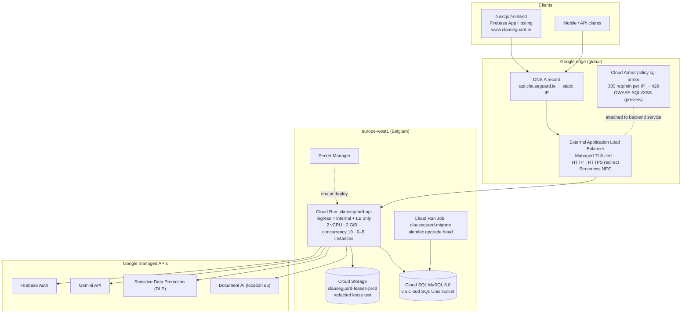

# ClauseGuard: Google Cloud Load Balancer & Edge Security Plan

**Project:** ClauseGuard (MSc Computer Science Project, TU Dublin)
**Author:** Prasad Nitin Pansare
**Date:** November 2026
**Infrastructure Target:** 100% Google Cloud Platform (GCP)
**Document Type:** Technical Architecture Specification & Implementation Plan

---

## 1. Summary

ClauseGuard's API runs on **Cloud Run** behind a **Global External Application Load Balancer** with **Cloud Armor**, all in one GCP project in `europe-west1` (St. Ghislain, Belgium). AWS S3 is replaced by **Cloud Storage**; Render and Vercel are retired.

Decisions taken in this revision:

| Decision | Choice | Reason |
| :--- | :--- | :--- |
| Load balancer | **Kept** — Global External ALB + serverless NEG | Single static IP, managed TLS, Cloud Armor, request logging, HTTP→HTTPS redirect |
| Edge security | **Cloud Armor** per-IP throttle + OWASP rules (preview first) | Global rate limit across all instances; WAF |
| Direct `*.run.app` access | **Blocked** (`--ingress=internal-and-cloud-load-balancing`) | Otherwise Cloud Armor and rate limits are bypassable |
| Memorystore Redis | **Not used** (see §8 for when to add it) | ~$36–55/month fixed cost to save <$15/month of Gemini calls; exact-match cache hit rate near zero |
| Serverless VPC Connector | **Not used** | Only needed for Redis/private IP; Cloud SQL is reached via the Cloud SQL Unix socket |
| Database migrations | **Cloud Run Job**, not container start-up | Scaled-out instances must not race on `alembic upgrade head` |
| Container registry | **Artifact Registry** | Container Registry (`gcr.io`) is retired |

Estimated cost: **~$45–60/month** at pilot scale (§7).

---

## 2. Architecture



Cloud Run is a managed service and does **not** sit inside a VPC; the load balancer reaches it through the serverless NEG.

---

## 3. Components

### 3.1 External Application Load Balancer
* Global, `EXTERNAL_MANAGED` scheme, static IPv4 `cg-lb-ip`.
* Serverless NEG `cg-serverless-neg` → Cloud Run service `clauseguard-api`.
* Google-managed certificate for `api.clauseguard.ie` (ACTIVE 15–60 minutes after DNS resolves).
* Second forwarding rule on port 80 that redirects to HTTPS.
* Request logging enabled on the backend service.
* **No LB health checks**: serverless NEGs do not support them. Health is handled by Cloud Run startup and liveness probes on `/health`.
* Request timeout comes from the Cloud Run service (300 s). Cloud Run's 32 MiB request limit is above ClauseGuard's 25 MB upload cap.

### 3.2 Cloud Armor (`cg-armor`)
| Priority | Rule | Action |
| :--- | :--- | :--- |
| 1000 | Every request, keyed on client IP, > 300/min | `deny-429` |
| 2000 | `sqli-v33-stable`, sensitivity 1 | `deny-403`, **preview** (log only) |
| 2001 | `xss-v33-stable`, sensitivity 1 | `deny-403`, **preview** (log only) |
| default | — | allow |

The OWASP rules start in preview because uploaded lease text is legal prose that can trip SQLi/XSS signatures. Review LB logs for a week, then enforce them.

### 3.3 Cloud Run (`clauseguard-api`)
| Setting | Value | Why |
| :--- | :--- | :--- |
| Ingress | `internal-and-cloud-load-balancing` | Blocks the public `run.app` URL |
| Auth | `--allow-unauthenticated` | The LB forwards end-user traffic; Firebase ID tokens are checked in the app |
| CPU / memory | 2 vCPU / 2 GiB | OCR, DLP and SpaCy work per request |
| Concurrency | 10 | 25 MB uploads processed in-request; 80 risks out-of-memory |
| Instances | min 0 (1 on demo days), max 5 | Cost; bounds Cloud SQL connections |
| Timeout | 300 s | Large-document OCR |
| Cloud SQL | attached via `--add-cloudsql-instances` | Unix socket, no public DB exposure needed |
| Identity | service account `clauseguard-api@` | No key files in the container |

### 3.4 Cloud Storage (replaces AWS S3)
* Bucket `clauseguard-leases-prod`, `europe-west1`, uniform bucket-level access, public access prevention, 7-day soft delete.
* Service account has `roles/storage.objectAdmin` **on this bucket only**.
* No lifecycle expiry: deleting an object while its DB row remains would break chat on older analyses. Retention is enforced by the app's delete endpoints (analysis delete and account delete both wipe the object).

---

## 4. Rate limiting: two layers

1. **Cloud Armor (global):** 300 requests/minute per client IP across all instances.
2. **slowapi in the app (per instance):** `RATE_LIMIT_API` / `RATE_LIMIT_AUTH`, in-memory. With up to 5 instances, a client can reach at most 5× the configured limit before Cloud Armor's ceiling applies.

### Real client IP behind the load balancer
The Google LB **appends** `<client-ip>,<lb-ip>` to any `X-Forwarded-For` value the client sends. The first entry is client-controlled and spoofable, so the app reads the entry immediately before the trusted proxies:

```python
# app/core/rate_limit.py
hops = [h.strip() for h in forwarded.split(",") if h.strip()]
return hops[-(settings.trusted_proxy_count + 1)]
```

`TRUSTED_PROXY_COUNT=1` on Cloud Run (set by the deploy script), `0` locally (header ignored).

---

## 5. Code changes (implemented)

| File | Change |
| :--- | :--- |
| `app/services/document/storage.py` | **New.** GCS `upload_text`, `download_text`, `delete_object`; typed `StorageUploadError` / `StorageDownloadError` / `StorageDeleteError`; one cached client per process; delete is idempotent on `NotFound` |
| `app/services/document/s3.py` | **Deleted** |
| `app/services/document/pipeline.py` | Uses `upload_text` and catches `StorageUploadError` → `PipelineError(step="upload")` |
| `app/api/translation_router.py`, `app/api/v1/endpoints/account.py`, `chat.py`, `documents.py` | Import from `storage.py` |
| `app/api/v1/endpoints/documents.py` | **Bug fix:** `DELETE /analyses/{id}` logged "Deleted" but never deleted the object; it now calls `delete_object` |
| `app/config.py` | Removed `aws_*`, `s3_bucket_name`; added `gcs_bucket_name`, `trusted_proxy_count`. All other settings kept (`database_url_sync` is required by Alembic) |
| `app/core/rate_limit.py` | Client-IP key function described in §4 |
| `app/core/firebase.py` | Uses the key file if present (local), otherwise Application Default Credentials (Cloud Run) |
| `requirements.txt` | Removed `boto3`; everything else unchanged |
| `Dockerfile` | Port 8080; migrations removed from `CMD` (opt-in with `RUN_MIGRATIONS=true` for local Docker) |
| `.dockerignore` | Excludes `firebase-service-account.json`, `secrets/`, key files and `.env.*` so credentials are never baked into the image |
| `.gcloudignore` | **New.** Keeps `.venv`, tests and credentials out of Cloud Build uploads |
| `.env.example` | GCS + `TRUSTED_PROXY_COUNT`; AWS removed; notes that `GCP_LOCATION` is the Document AI location (`eu`), not a region |
| `alembic/versions/0006_rewrite_s3_uris_to_gcs.py` | **New.** Rewrites `documents.s3_uri` from `s3://…` to `gs://<GCS_BUCKET_NAME>/<s3_key>`. Column names are unchanged to avoid an API/frontend change |
| `infra/gcp/setup_load_balancer.sh` | **New.** Provisioning script (§6) |

Not changed in this revision: Gemini still uses `GEMINI_API_KEY` (stored in Secret Manager). Moving to Vertex AI is a separate change.

---

## 6. Deployment

Full walkthrough (what/why/how for every step, DNS, secrets, troubleshooting): [`NEW_DEPLOYMENT_GUIDE.md`](NEW_DEPLOYMENT_GUIDE.md).

All steps are in `infra/gcp/setup_load_balancer.sh`. Run one step at a time the first time:

```bash
export PROJECT_ID=clauseguard-512316 DOC_AI_PROCESSOR_ID=<id>
cd infra/gcp
STEP=apis    ./setup_load_balancer.sh   # enable APIs
STEP=iam     ./setup_load_balancer.sh   # runtime service account + roles
STEP=bucket  ./setup_load_balancer.sh   # GCS bucket + bucket-level IAM
STEP=build   ./setup_load_balancer.sh   # Cloud Build -> Artifact Registry
STEP=migrate ./setup_load_balancer.sh   # Cloud Run Job: alembic upgrade head
STEP=service ./setup_load_balancer.sh   # Cloud Run, LB-only ingress
STEP=lb      ./setup_load_balancer.sh   # IP, NEG, backend, cert, HTTPS + redirect
STEP=armor   ./setup_load_balancer.sh   # Cloud Armor policy, attach to backend
STEP=verify  ./setup_load_balancer.sh   # run.app blocked, LB returns 200
```

Before running, create these secrets in Secret Manager:

| Secret | Value |
| :--- | :--- |
| `cg-database-url` | `mysql+aiomysql://USER:PW@/clauseguard?unix_socket=/cloudsql/PROJECT:europe-west1:clauseguard-db` |
| `cg-database-url-sync` | `mysql+pymysql://USER:PW@/clauseguard?unix_socket=/cloudsql/PROJECT:europe-west1:clauseguard-db` |
| `cg-gemini-api-key` | Gemini API key |

### Data move (S3 → GCS)
1. Storage Transfer Service job from `s3://<old-bucket>` to `gs://clauseguard-leases-prod` (keys are preserved).
2. At cutover: pause uploads, run an incremental transfer, compare object counts.
3. Run the migrate job with `GCS_BUCKET_NAME` set so 0006 rewrites the URIs.

### Cutover
1. Lower DNS TTL to 300 s two days before.
2. Add the A record `api.clauseguard.ie → cg-lb-ip`; wait for the certificate to become ACTIVE.
3. Set the frontend `NEXT_PUBLIC_API_URL=https://api.clauseguard.ie/api`.
4. After cutover, remove `0.0.0.0/0` from Cloud SQL authorised networks.

---

## 7. Estimated monthly cost (USD, approximate list prices)

| Item | Pilot | Notes |
| :--- | ---: | :--- |
| Load balancer forwarding rules (HTTPS + HTTP redirect) | 18–20 | Charged per rule-hour; data processing ~$0.008/GB extra |
| Cloud Armor (1 policy + 3 rules + requests) | 8–9 | ~$5 policy, ~$1/rule, ~$0.75 per million requests |
| Cloud SQL `db-f1-micro` + 10 GB SSD + backups | ~12 | Unchanged |
| Cloud Run (min 0) | 0–5 | ~$25–30 extra for each month at `min-instances=1` with 2 vCPU / 2 GiB |
| Document AI OCR | ~4.50 | $1.50 per 1,000 pages, ~3,000 pages |
| Gemini, GCS, Secret Manager, Artifact Registry, logging | 2–4 | |
| **Total** | **~45–60** | Without Redis/VPC connector (~$50–65 saved per month) |

Check the [Google Cloud pricing calculator](https://cloud.google.com/products/calculator) before committing.

---

## 8. When to add Memorystore (Redis)

Add it only if one of these becomes true:

* Per-instance rate limits are too loose (many instances running) and Cloud Armor's per-IP throttle is not granular enough per route.
* Gemini spend exceeds ~$50/month **and** logs show repeated identical questions (measure the hit rate first).
* Session or job state must be shared across instances.

If added: use **Direct VPC egress** (not a Serverless VPC Connector), enable **AUTH and in-transit encryption**, set slowapi `swallow_errors=True` so a Redis outage does not fail every request, delete `cg:cache:doc:{id}:*` keys on analysis/account delete (GDPR), and check document ownership before serving cached summaries.

---

## 9. Verification checklist

- [ ] `curl https://<service>.run.app/health` → **blocked** (ingress restriction)
- [ ] `curl https://api.clauseguard.ie/health` → `200 {"status":"ok"}`
- [ ] `curl http://api.clauseguard.ie/health` → `301` to HTTPS
- [ ] Certificate status `ACTIVE`
- [ ] 301 requests in one minute from one IP → `429` from Cloud Armor
- [ ] Spoofed `X-Forwarded-For: 1.1.1.1` header does **not** change the rate-limit key
- [ ] Upload a lease → object appears in `gs://clauseguard-leases-prod/documents/<user>/`
- [ ] Delete the analysis → object removed from GCS
- [ ] Delete the account → all the user's objects removed
- [ ] Clause Q&A works (reads lease text from GCS)
- [ ] Firebase login works from `www.clauseguard.ie`
- [ ] Cloud Armor preview logs reviewed before enforcing OWASP rules

---

## 10. Academic justification (for the dissertation)

1. **GDPR and EU data residency:** compute, storage, database and the document pipeline run in `europe-west1` (Belgium) and Document AI's `eu` location, so lease data stays inside the EU. GCP has no Irish region; GDPR applies EU-wide, so this meets the same obligations as hosting in Ireland.
2. **Horizontal scalability:** the load balancer and serverless NEG spread traffic over 0–5 stateless Cloud Run instances. Statelessness comes from keeping all persistent state in Cloud SQL and Cloud Storage.
3. **Defence in depth:** Cloud Armor (edge, global per-IP limit and WAF) → LB-only ingress → Firebase token checks → per-route app limits → least-privilege service account with no key files.
4. **Cost-aware design:** a distributed cache was evaluated and deferred because its fixed cost exceeded the API spend it would save at current load; §8 records the conditions under which it becomes worthwhile.
